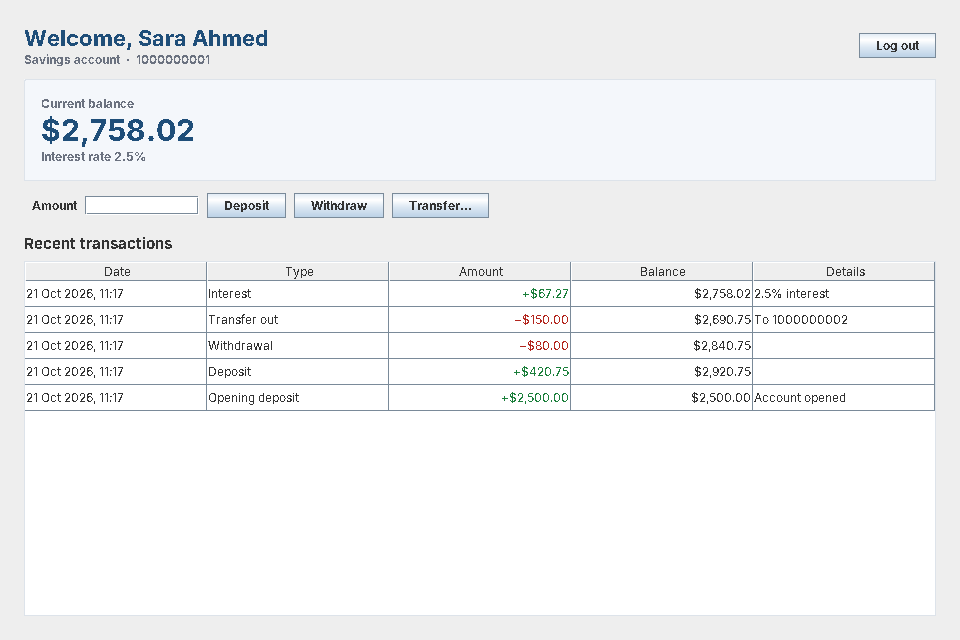
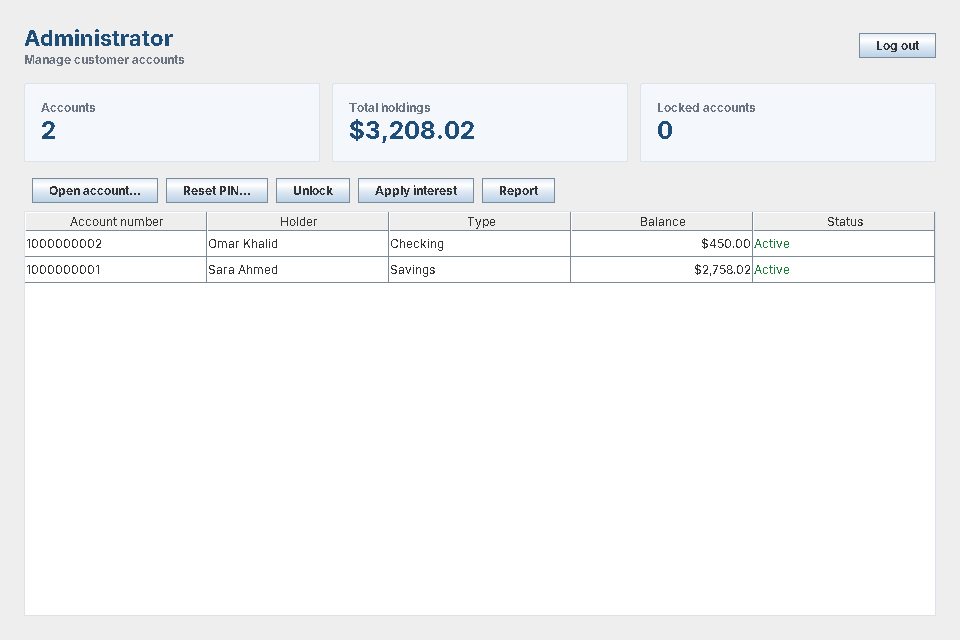
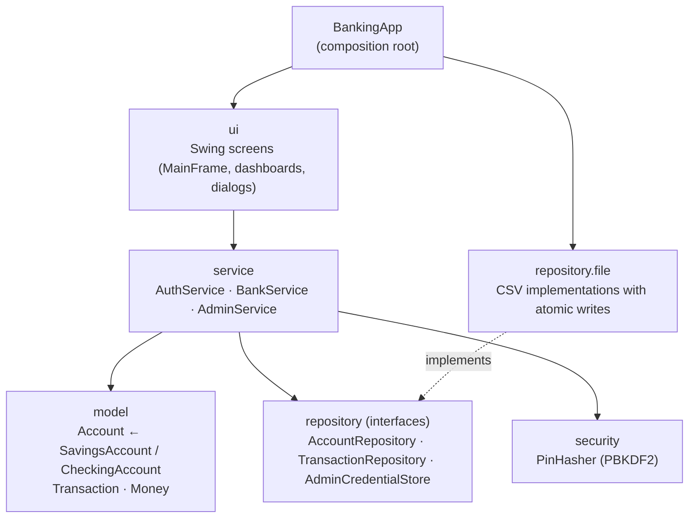

# Banking System


A desktop banking application written in Java and Swing. Customers can deposit, withdraw, transfer money and view their statement. Administrators can open accounts, reset PINs, unlock accounts, pay interest and run reports.

<p align="center">
  
  
</p>

---

## Features

**Customers**
- Log in with a 10-digit account number and a 4-digit PIN
- Deposit, withdraw and transfer money between accounts
- Statement with colour-coded credits and debits and the running balance
- **Savings** accounts earn interest. **Checking** accounts have overdraft protection.

**Administrators**
- On first launch, the app asks you to create an admin password (nothing is hard-coded)
- Open accounts, with an auto-generated unique account number and an optional opening deposit
- Reset a customer's PIN or unlock a locked account
- Pay interest to every savings account in one batch
- View a dashboard and a report with totals for deposits, withdrawals, transfers and interest

**Security**
- PINs and the admin password are hashed with **PBKDF2-HMAC-SHA256** (600,000 iterations, random salt per record)
- An account **locks after 3 wrong PINs**. The counter is saved, so restarting the app does not reset it.
- An unknown account number gets the same error as a wrong PIN, so the login screen cannot be used to find valid accounts
- Secrets are handled as `char[]` and wiped from memory after use
- Hashes are compared in constant time

## Quick start

Requires **Java 17+** and **Maven 3.8+**.

```bash
mvn package                      # compiles, runs all tests, builds target/banking-system.jar
java -jar target/banking-system.jar
```

Or run it straight from source with `mvn compile exec:java`.

On first launch, two demo accounts are created:

| Account number | PIN    | Type     | Holder      |
|----------------|--------|----------|-------------|
| `1000000001`   | `1234` | Savings  | Sara Ahmed  |
| `1000000002`   | `4321` | Checking | Omar Khalid |

Choose **Administrator login** to set the admin password the first time.

Data is stored in `./data/`, which git ignores. You can change it with `-Dbanking.dataDir=/some/path`. To start without demo accounts, use `-Dbanking.demo=false`.

## Architecture

The code is split into layers. Each layer only depends on the layer below it.



```
src/main/java/com/zainabtaha/banking/
├── BankingApp.java          # main(): wires everything together
├── model/                   # domain objects and business rules, no I/O
├── security/                # PIN / password hashing
├── repository/              # storage interfaces
│   └── file/                # CSV implementation
├── service/                 # use cases: login, deposit, transfer, open account, ...
└── ui/                      # Swing screens, no business logic
```

**Design decisions**

| Decision | Why |
|---|---|
| **Repository interfaces** between services and storage | Services never touch files. Tests use fast in-memory fakes, and moving to a database would only need a new implementation. |
| **Constructor injection** with one composition root (`BankingApp`) | No hidden globals or `new` calls inside services, so every class can be tested on its own. |
| **Template method** for withdrawals (`Account.withdraw` is `final` and asks `availableFunds()`) | `CheckingAccount` adds an overdraft by overriding one method, without repeating or bypassing the validation. |
| **`BigDecimal` for money**, two decimal places, banker's rounding | `double` cannot store 0.10 exactly, so errors build up over many transactions. |
| **Injected `Clock`** | Timestamps can be tested without depending on the real time. |
| **Atomic file writes** (write to a temp file, then rename it) | A crash in the middle of saving never leaves a half-written accounts file. |
| **Proper CSV quoting** | Names containing commas or quotes, such as `Doe, Jane`, are stored and read back correctly. |
| **`SwingWorker`** for slow operations | Password hashing deliberately takes a fraction of a second, and running it in the background keeps the window responsive. |
| **One window with `CardLayout`** | Smoother than opening and closing a new `JFrame` for every screen. |

## Testing

```bash
mvn test
```

There are 62 JUnit 5 tests covering:

- **Model:** exact money maths, overdraft limits, interest rounding, lockout state and input validation (parameterised tests)
- **Security:** hash and verify, unique salts, malformed hashes, reading hashes created with a different iteration count
- **Repositories:** CSV round-trips (including names with commas and quotes), rejection of corrupt files, data surviving a reload
- **Services:**
  - login and lockout
  - a failed transfer leaves both accounts unchanged
  - duplicate account numbers are rejected
  - reports add up correctly
- **End-to-end:** real file storage across simulated app restarts

GitHub Actions runs the build on **Linux, Windows and macOS** for every push.

## Possible next steps

- Swap the CSV repositories for SQLite/JDBC with real database transactions. The service layer would not change.
- Let customers change their own PIN and export their statement as CSV or PDF
- Add an audit log of admin actions
- Package native installers with `jpackage`

## Credits

Originally developed as a team project by **Zainab Taha** and **Leen Dalloul** ([original repository](https://github.com/leendalloul/Project-)).
